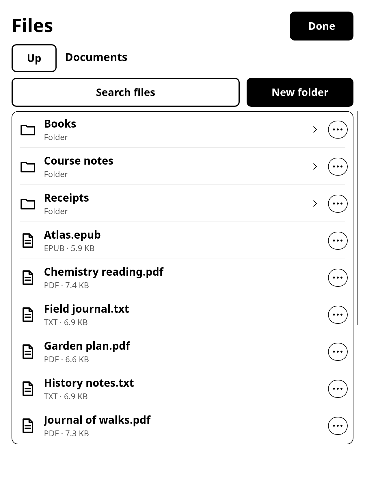

# Files

**Browse and organise Kindle files**

  

[**Download**](https://github.com/PrimitiveOS/kindle-primitive-files/releases/latest) · [**Install guide**](INSTALL.md) · [**Changelog**](CHANGELOG.md)

---

Browse Documents and other supported user folders. Search by filename, create folders, rename, copy or move entries, and remove files and empty folders. Open supported documents in an installed Reader, Viewer, or KOReader.

## Quick start

After setting up PrimitiveOS, open **Store** from Primitive Launcher. Choose **Files** under **Apps**,
tap **Get**, and open it from the Launcher grid. The [install guide](INSTALL.md) also covers the standalone USB package.

## Screenshots

| Documents | File actions | Dark mode |
|---|---|---|
|  |  |  |

Desktop simulation at the Kindle Oasis 3 resolution with sample filenames.

## Highlights

- Browse Documents and other supported user folders.
- Search by filename, create folders, rename, copy or move entries, and remove files and empty folders.
- Open supported documents in an installed Reader, Viewer, or KOReader.

## Status

| Device | Status |
|---|---|
| Kindle Oasis 3 (1264 × 1680, firmware 5.18.2) | Tested on hardware |

**Current version: 0.1.4.** Changes are in [CHANGELOG.md](CHANGELOG.md).

## Downloads

**42 downloads** from Store, as of 2026-11-21. Store shows the same count on the app page.
The count is GitHub downloads of this app's release packages, from the [Store catalog](https://primitiveos.github.io/kindle-primitive-catalog/v1/index.json).

## Documentation

[Install guide](INSTALL.md) · [Changelog](CHANGELOG.md)

## Licence

Copyright (C) 2026 Doan Nguyen.

The app code is licensed under PolyForm Noncommercial 1.0.0. [Code license](LICENSE)

Original documentation, screenshots, and artwork are licensed under CC BY-NC-SA 4.0.
[Documentation and image license](LICENSE-DOCS)
