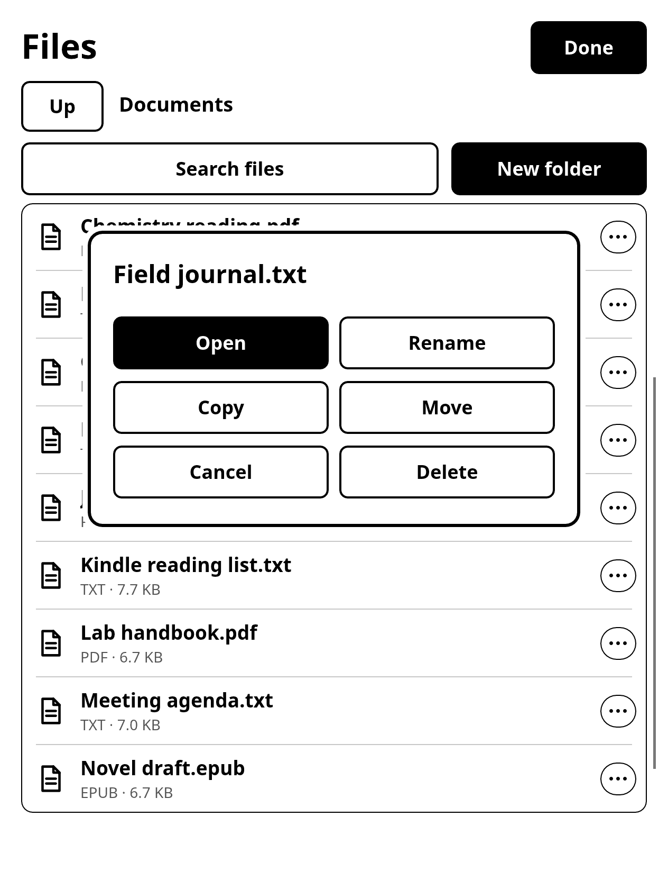
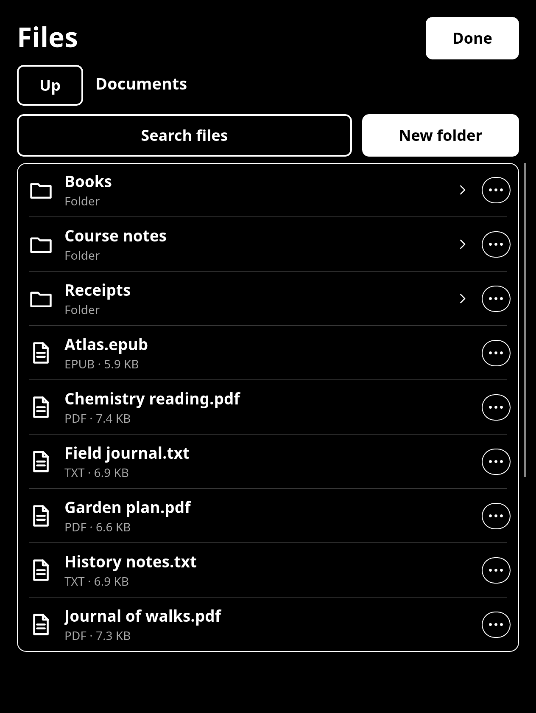

<div align="center">


# Files

**Browse and organise files on your Kindle.**

[Install guide](INSTALL.md) · [Changelog](CHANGELOG.md)

</div>

Files is a standalone app for PrimitiveOS. It opens in **Documents**, with a vertical list and fixed navigation.
Tap a folder to browse it or a supported book or PDF to open it in KOReader. Use the row’s menu for file actions.

## Screenshots

| Documents | File actions | Dark mode |
|---|---|---|
|  |  |  |

<sub>Desktop simulation at the Kindle Oasis 3 resolution with sample filenames.</sub>

## Using Files

- **Browse and search.** Swipe vertically or use the Kindle page buttons. Tap **Up** to browse supported
  user folders. Search matches names in the current folder.
- **Organise.** Create folders and rename files or folders. Choose **Copy** or **Move**, browse to the
  destination, and tap **Paste**. An existing file with the same name stays intact.
- **Delete.** Confirm removal of a file or empty folder. You can move or copy folders with contents.
- **Open a document.** Files hands supported books and PDFs to an installed KOReader. Closing KOReader returns
  to Launcher.

## Build and preview

Keep `doannt-kindle-tools` and `doannt-kindle-launcher` beside this checkout.

```sh
cargo test --offline --locked --workspace
cargo run --offline --locked -p files-kindle --features desktop-preview --bin files-desktop -- build/previews
cargo zigbuild --offline --locked --release -p files-kindle --target armv7-unknown-linux-musleabihf
sh scripts/stage.sh armhf
```

## Status

Files 0.1.0 passed the desktop interaction tests and opened from its installed package on a Kindle Oasis 3
running firmware 5.18.2. The owner verified that opening a sample PDF from Files displayed it in KOReader.

## Licence

Copyright (C) 2026 Doan Nguyen.

The app code is licensed under PolyForm Noncommercial 1.0.0. [Code license](LICENSE)

Original documentation, screenshots, and artwork are licensed under CC BY-NC-SA 4.0.
[Documentation and image license](LICENSE-DOCS)
